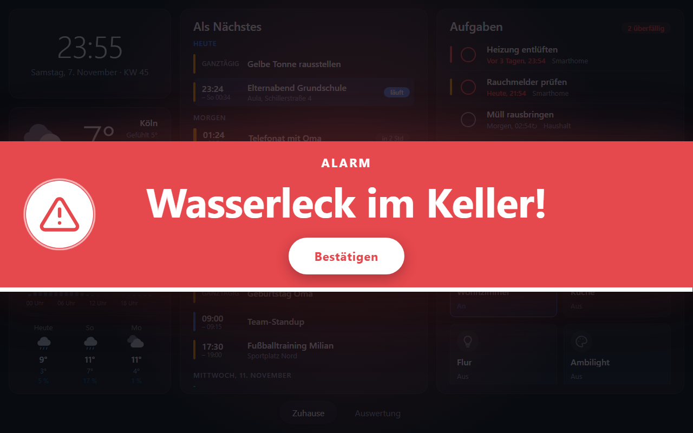
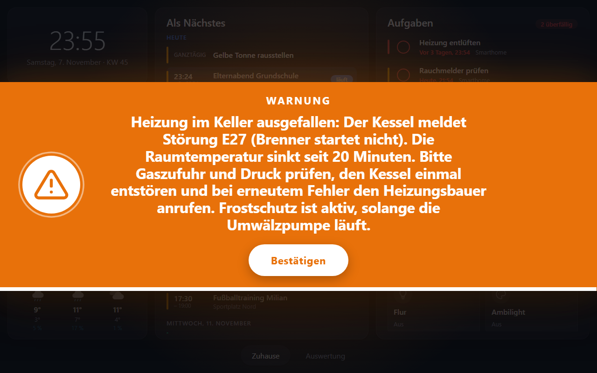

# Lumina

A self-hosted, responsive home dashboard for a wall-mounted tablet. A Go backend polls your services and pushes live updates over one WebSocket to a lightweight Svelte frontend. Everything is rendered natively (no iFrames), via widgets.

- Widgets and their configuration: [WIDGETS.md](WIDGETS.md)
- Urgent alerts via REST (overlay with optional confirm button): [docs/alerts.md](docs/alerts.md)
- Requirements: [docs/requirements.md](docs/requirements.md)
- Architecture decisions: [docs/adr/](docs/adr/README.md)

## Status

- M0 (foundations): done. Server, WebSocket protocol, config with hot reload, frontend shell, widget registry, container build.
- M1 (first integration): weather via Open-Meteo (`weather.forecast`), the in-memory history store (`backend/internal/history`) and the native SVG chart component. Done.
- M2 (first widget with actions): Vikunja (`vikunja.tasks`): open tasks with due dates, overdue highlighted and sorted first, complete with undo, quick add. Done.
- M3 (live streaming + control): openHAB (`openhab.sitemap`): a sitemap shown natively, live via the event stream, switches and mapping buttons operable. Done.
- M4 (dashboard features): openHAB sliders (dimmers, blinds with up/stop/down, numeric setpoints), page auto-rotation, night mode (dim or clock), nightly soft reload, lite mode. Done.
- M5 (calendar): `calendar.agenda` merges iCal feeds (Google secret address and others): recurrence, time zones, all-day events, agenda plus month overview. Done.
- M6 (Grafana and typed settings): `grafana.panel` draws a panel of an existing dashboard as chart, stat or gauge through Grafana's query API (any datasource). All widget settings are now typed Go structs: validated strictly when the config is loaded (a typo is an error that lists the valid settings) and generated to TypeScript. Done.
- M7 (electricity prices): `tibber.prices` shows the current Tibber price and a chart of the 15-minute prices of today and tomorrow. Done.
- Next: Paperless-ngx; color pickers and selections for openHAB; a week view for the calendar.

Widgets: `calendar.agenda`, `core.clock`, `grafana.panel`, `openhab.sitemap`, `tibber.prices`, `vikunja.tasks` (optional webhook receiver for instant updates), `weather.forecast` (a card adapts to its size: compact shows current conditions, taller cards add the 24 h chart and the 7-day forecast).

### Tibber electricity prices

`tibber.prices` shows the current price and a chart of all published prices of today and tomorrow. It uses the Tibber Data API, which needs an OAuth client:

1. Create the client at <https://data-api.tibber.com/clients/manage> with the redirect URI `http://localhost:8080/`. The token must have the scope **`data-api-prices-read`** (plus `data-api-homes-read` to find your home); without it the prices request fails with 403.
2. Log in once to get the refresh token: `TIBBER_CLIENT_ID=... TIBBER_CLIENT_SECRET=... go run ./cmd/tibber-auth` (in `backend/`; it requests these scopes and prints `TIBBER_REFRESH_TOKEN=...`).
3. Add the `tibber` connection and the widget, see [WIDGETS.md](WIDGETS.md#tibberprices) and [config/config.example.yaml](config/config.example.yaml).

## Layout

```
backend/    Go module (cmd/lumina, internal/{config,core,server,widget,widgets/<type>,web})
frontend/   Svelte 5 + Vite SPA (src/{lib,components,widgets/<type>,styles,i18n})
config/     example configuration
deploy/k8s/ example Kubernetes manifests
scripts/    demo.ps1 (builds and starts the all-in-one demo), send-alert.ps1 (sends a test alert)
```

## Develop

Needs Go 1.24+ and Node 22+.

```sh
# 1. backend (serves the embedded frontend and /ws on :8080)
cd backend
go run ./cmd/lumina -config ../config/config.example.yaml

# 2. frontend dev server with hot reload (proxies /ws to :8080)
cd frontend
npm install
npm run dev        # http://localhost:5173
```

For the dev server the WebSocket origin must be allowed: add `server: { allowedOrigins: ["localhost:5173"] }` to your config.

Build everything into one binary:

```sh
cd frontend && npm run build      # writes into backend/internal/web/dist
cd ../backend && go build -o lumina ./cmd/lumina
```

Types shared with the frontend are generated from the Go data models (`model.go` per widget, `config/client.go`, `core/protocol.go`) into `frontend/**/*.gen.ts` by [tygo](https://github.com/gzuidhof/tygo). These files are **not committed** (git-ignored). The container build and the release pipeline generate them on every run; locally, run this in `backend/` once after cloning (before `npm run dev`, `npm run check` or `npm run build`) and again after changing a model:

```sh
go tool tygo generate
```

Tests and checks:

```sh
cd backend && go test ./...
cd frontend && npm run check
```

## Display behaviour

The optional `display` section of the config controls the always-on screen. Everything in it is optional; the defaults are shown below. A complete example is in [config/config.example.yaml](config/config.example.yaml).

```yaml
display:
  rotate:
    enabled: false
    intervalSeconds: 30
    pauseSeconds: 60
  night:
    from: ""            # no night window unless from and to are set
    to: ""
    mode: dim
    dim: 0.75
    wakeSeconds: 30
  softReload: "03:30"
  lite: false
  transition:
    type: fade
    durationMs: 300
```

| Setting | Type | Default | Description |
| --- | --- | --- | --- |
| `rotate.enabled` | bool | `false` | Cycle through the pages automatically. Has no effect with fewer than two pages or when a [home page](#home-page) is set. |
| `rotate.intervalSeconds` | int, at least 5 | `30` | Time spent on each page. |
| `rotate.pauseSeconds` | int, 0 or more | `60` | A touch pauses the rotation for this long. |
| `night.from`, `night.to` | time `HH:MM` | not set | Start and end of the night window, in the tablet's own clock. The window may span midnight. Set both or neither. They must differ. |
| `night.mode` | `dim` \| `clock` | `dim` | `dim` darkens the dashboard. `clock` shows only a clock. |
| `night.dim` | number, 0 to 0.95 | `0.75` | `dim` mode: how dark the overlay is (0 = not at all). |
| `night.wakeSeconds` | int, at least 5 | `30` | `clock` mode: a touch shows the dashboard for this long. |
| `softReload` | time `HH:MM` or `""` | `"03:30"` | Daily page reload as a safety net for 24/7 operation. `""` turns it off. |
| `lite` | bool | `false` | No animations or shadows, for weak devices. Also switches off the page transition. |
| `transition.type` | `fade` \| `fly` \| `slide` \| `crossfade` \| `scale` \| `blur` | `fade` | Animation when the page changes, see [Page transition](#page-transition). |
| `transition.durationMs` | int, 50 to 2000 | `300` | Duration of that animation in milliseconds. |

Night mode is software only: it does not control the real screen or its brightness. Invalid values reject the config at startup with an error naming the setting.

Examples:

```yaml
# Dim the dashboard every night
display:
  night: { from: "23:00", to: "06:00", mode: dim, dim: 0.8 }

# Show only a clock at night; a touch shows the dashboard for 45 seconds
display:
  night: { from: "22:30", to: "06:00", mode: clock, wakeSeconds: 45 }

# Rotate through the pages every 20 seconds; a touch pauses it for two minutes
display:
  rotate: { enabled: true, intervalSeconds: 20, pauseSeconds: 120 }

# No daily reload, no animations (weak tablet)
display:
  softReload: ""
  lite: true
```

### Page transition

`display.transition` sets the animation when the page changes (tap, swipe, rotation or the return to the home page). It is one global setting for all pages. Without it, the new page fades in over 300 ms.

| `type` | Effect |
| --- | --- |
| `fade` | The old page disappears at once, the new page fades in. This is the default. |
| `fly` | Pages fly sideways in the direction of the tab order: moving to a later page pushes the old one out to the left, moving back pushes it out to the right. |
| `slide` | The old page collapses sideways to nothing while the new one unfolds from nothing. The page content is laid out again while it moves, so it can look jumpy; `fly` is smoother. |
| `crossfade` | The old page fades out while the new one fades in, so the two overlap. |
| `scale` | Crossfade with a slight zoom: the new page grows from 96% to 100%, the old one shrinks to 96%. |
| `blur` | Crossfade with a blur: the old page blurs out while the new one comes into focus. Blur can be slow on weak tablets, so test it on the device. |

`durationMs` applies to every type: smaller is faster. With `lite: true` there is no animation at all, whatever is configured. `fly` and `slide` clip the page area while moving, so widget shadows at the screen edge can be cut off during the move.

One example per type, plus the speed on its own:

```yaml
# Nothing configured: same as type: fade, durationMs: 300
display: {}

# Only the speed: the type stays fade
display:
  transition: { durationMs: 600 }

# fade: the new page fades in, slowly
display:
  transition: { type: fade, durationMs: 600 }

# fly: sideways in the direction of the tab order, quick
display:
  transition: { type: fly, durationMs: 250 }

# slide: collapse and unfold
display:
  transition: { type: slide, durationMs: 400 }

# crossfade: calm overlap
display:
  transition: { type: crossfade, durationMs: 500 }

# scale: crossfade with a slight zoom
display:
  transition: { type: scale, durationMs: 350 }

# blur: crossfade with a blur
display:
  transition: { type: blur, durationMs: 400 }

# Combined with other display settings
display:
  transition:
    type: fly          # fade | fly | slide | crossfade | scale | blur
    durationMs: 350    # 50..2000
  rotate: { enabled: false }
  lite: false
```

### Home page

Mark one page with `home: true` to make it the home page:

```yaml
pages:
  - id: home
    title: Home
    home: true
    widgets: [...]
```

- The home page shows a small house icon next to its title in the page bar.
- When another page is selected (tap or swipe) and nobody touches the screen for 30 seconds, the dashboard switches back to the home page. Every touch restarts the 30 seconds. The delay is fixed.
- At most one page can be `home`; the config is rejected otherwise.
- While a home page is set, automatic page `rotate` is disabled, because the two would fight over the current page.

## Webhooks (Vikunja)

Lumina receives Vikunja webhooks at `POST /api/webhooks/vikunja/<connection name>`. An event only triggers a fresh fetch of the task list (the payload is not used), so changes show up after about a second and the list can never contain a task twice. Optional HMAC signature (`webhookSecret`) and basic auth (`webhookUser`/`webhookPassword`) are enforced once configured. Details and setup: [WIDGETS.md](WIDGETS.md#vikunja-webhook-receiver).

## Urgent alerts

`POST /api/alerts` shows a large overlay on every connected dashboard: red or orange, with your text (smaller type for long texts), disappearing after the time you give, and an optional confirm button that makes Lumina call a URL you provide.





```powershell
.\scripts\send-alert.ps1 -Text 'Water leak in the basement!' -Color red -Seconds 60 -Confirm
```

All fields, behaviour, more screenshots and PowerShell/curl examples: [docs/alerts.md](docs/alerts.md).

## Demo

`scripts/demo.ps1` (Windows PowerShell) builds everything and starts a demo with **every integration** (page 1: clock, weather, calendar, Vikunja tasks, openHAB; page 2: Grafana as chart, gauge and stat; Strom page: Tibber prices) using [config/config.demo.yaml](config/config.demo.yaml). It needs no secrets and touches none of your real systems:

- `backend/mocks/demo-services` is a stand-in for openHAB (sitemap `Demo`: lights, dimmer, blinds, heating mode, live values), Vikunja (token `demo`; complete, undo, quick add, a recurring task), Grafana (token `demo`; a dashboard with generated household curves), Tibber (generated prices of today and tomorrow) and two iCal feeds, all with dates relative to now. State lives in memory; restart to reset.
- Weather is live from Open-Meteo, so you need an internet connection. The calendar also includes Google's public holiday calendar.

```powershell
.\scripts\demo.ps1                 # http://localhost:8080, opens the browser, Ctrl+C stops everything
.\scripts\demo.ps1 -Port 9000 -NoBrowser -SkipBuild
```

Without PowerShell: `go run ./mocks/demo-services` (in `backend/`) and `go run ./cmd/lumina -config ../config/config.demo.yaml`, after `npm run build` in `frontend/`.

To try your own systems, copy the demo config and replace the `connections` (see the comments in the file).

## Container

```sh
docker build -t lumina --build-arg VERSION=0.1.0 .
docker run --rm -p 8080:8080 -v "$PWD/config/config.example.yaml:/config/config.yaml:ro" lumina
```

Kubernetes: see [deploy/k8s/lumina.yaml](deploy/k8s/lumina.yaml). Keep one replica. The dashboard has no login and is meant for the LAN only; do not expose it to the internet. Use `readOnly: true` on widgets that must not control anything.

## Configuration

Settings are validated strictly when the file is loaded: an unknown or mistyped setting (say `dueTo` instead of `due`) or a wrong value is an error that names the widget and lists the valid settings, and the previously loaded configuration stays active.

See [config/config.example.yaml](config/config.example.yaml). The file is watched and reloaded automatically (also for ConfigMap mounts). An invalid edit is logged and ignored; the last good configuration stays active. `${VAR}` references are replaced by environment variables before parsing.

### Card style

`theme.style` sets the look of all widget cards on all pages (it applies globally, not per widget or page):

| Value | Look |
| --- | --- |
| `flat` (default) | Plain, opaque cards with a thin border and a light shadow. |
| `glass` | Frosted glass: the background is blurred behind the card, a soft highlight runs across the top and a bright edge catches the light. Follows the light/dark mode. |
| `holo` | Holographic: an iridescent cyan, violet, pink and gold sheen, a neon edge glow and a violet shadow. Follows the light/dark mode. |
| `holo-dark` | Calm, dark holographic: near-black navy cards (also in light mode, with light text), a blue-only sheen and a blue edge glow. |

```yaml
theme:
  style: holo-dark                   # flat (default) | glass | holo | holo-dark
  widgetOpacity: 0.85                # optional: lets the background show through the (blurred) cards
```

The blur is most visible with a background picture and a `widgetOpacity` below 1. `glass`, `holo` and `holo-dark` are switched off (flat) when `display.lite` is on. An unknown value is a configuration error.

### Background picture

`theme.background` sets a picture behind the widgets, one for the light and one for the dark color scheme (each optional; `theme.mode: auto` follows the device):

```yaml
theme:
  widgetOpacity: 0.8                 # optional: opacity of the widget cards, 0.1..1 (default 1)
  background:
    light: dawn                      # name of an embedded picture, without file extension
    dark: /wallpapers/evening.jpg    # or the path of your own file
```

`theme.widgetOpacity` (0.1 to 1, default 1) makes the widget cards translucent so the picture shows through; text and charts stay fully opaque. Lower values reduce contrast, so keep it readable (0.7 to 0.9 works well).

Embedded pictures (referenced by file name without extension): light `dawn`, `mist`, `meadow`; dark `night`, `aurora`, `dusk`. A value with a `/` or `\` is a file path (jpg, png, webp, avif, gif, svg), for instance a volume mounted into the container: `docker run -v "$PWD/wallpapers:/wallpapers:ro" ...`. A missing name or file is a configuration error. Replacing the file on disk takes effect on the next config reload or page reload. The pictures are scaled to cover the screen; keep them calm and low contrast (and small, they are loaded by the tablet over WiFi). The examples are generated by `go run ./cmd/genbackgrounds` in `backend/`.

## Adding a widget

1. Backend: a package in `backend/internal/widgets/<name>` that implements `widget.Provider` (plus `Poller`/`Streamer`/`Actor` as needed) and calls `widget.Register` in `init()`; add a blank import in `cmd/lumina/main.go`.
2. Frontend: a component in `frontend/src/widgets/<name>/` and one `registerWidget` line in `frontend/src/widgets/index.ts`.
3. Use it in the config under `pages[].widgets[]`.

See [ADR-004](docs/adr/004-widget-contract.md) for the contract.
