# Lumina widgets

Reference for all available widgets and their configuration. For installation and general setup see [README.md](README.md); for a complete configuration file see [config/config.example.yaml](config/config.example.yaml).

Settings are validated strictly when the config is loaded: an unknown or mistyped setting is an error that names the widget and lists the valid settings, and the previously loaded configuration stays active.

## Overview

| Type | Purpose | Connection | Interactive |
|---|---|---|---|
| [`core.clock`](#coreclock) | Clock with optional time zone | none | no |
| [`weather.forecast`](#weatherforecast) | Current weather, 24 h chart, 7-day forecast (Open-Meteo) | none | no |
| [`calendar.agenda`](#calendaragenda) | Agenda and month overview from iCal feeds | one per calendar, listed in `settings.calendars` | no |
| [`vikunja.tasks`](#vikunjatasks) | Open Vikunja tasks, complete with undo, quick add | `vikunja` | yes |
| [`openhab.sitemap`](#openhabsitemap) | An openHAB sitemap, live, operable | `openhab` | yes |
| [`grafana.panel`](#grafanapanel) | A Grafana panel as chart, stat, gauge or battery | `grafana` | no |
| [`mqtt.value`](#mqttvalue) | One numeric MQTT value as stat, gauge, chart or battery | `mqtt` | no |

## Common widget fields

Every entry under `pages[].widgets[]` has these fields; the widget-specific options go under `settings`.

| Field | Type | Required | Default | Description |
|---|---|---|---|---|
| `id` | string | yes | | Unique widget id. |
| `type` | string | yes | | One of the widget types above. |
| `pos` | `{ x, y, w, h }` | yes | | Position and size in grid cells (the grid is set by `grid.columns` and `grid.rows`). |
| `connection` | string | depends | | Name of an entry under top-level `connections`. Secrets (URLs, tokens) live only there and never reach the browser. |
| `readOnly` | bool | no | `false` | Disables all write actions of the widget. Has an effect on `vikunja.tasks` and `openhab.sitemap`. |
| `alwaysOn` | bool | no | `false` | Keep polling or streaming even when no browser is subscribed. |
| `settings` | map | depends | | The widget-specific options described below. |

---

## core.clock

A clock. Needs no connection.

| Setting | Type | Required | Default | Description |
|---|---|---|---|---|
| `timezone` | string | no | the device's time zone | IANA name, e.g. `Europe/Berlin`, `UTC`. |
| `showSeconds` | bool | no | `false` | Show seconds. |
| `hour12` | bool | no | `false` | 12-hour clock with am/pm. |
| `label` | string | no | | Small caption above the time. |

```yaml
- id: clock-utc
  type: core.clock
  pos: { x: 2, y: 0, w: 2, h: 1 }
  settings:
    timezone: UTC
    label: UTC
    showSeconds: true
```

---

## weather.forecast

Weather from Open-Meteo, no API key. Needs internet access. The card adapts to its size: small shows the current conditions, taller cards add the 24 h chart and the 7-day forecast. Data is refreshed every 15 minutes.

Give either `location` or both `latitude` and `longitude`.

| Setting | Type | Required | Default | Description |
|---|---|---|---|---|
| `location` | string | one of location / coordinates | | Place name, looked up once through Open-Meteo geocoding. |
| `latitude` | number | with `longitude` | | Latitude in degrees. |
| `longitude` | number | with `latitude` | | Longitude in degrees. |
| `label` | string | no | the geocoded name | Display name. |

```yaml
- id: weather
  type: weather.forecast
  pos: { x: 0, y: 1, w: 4, h: 3 }
  settings:
    location: Köln          # or: latitude: 50.94 / longitude: 6.96
    label: Zuhause
```

---

## calendar.agenda

Merges iCal feeds (Google secret address, Nextcloud, any `.ics`), expands recurring events, handles time zones and all-day events. Read-only. Shows an agenda grouped by day (the running event is highlighted); with enough room also a month overview with colored dots. Feeds are fetched with conditional requests.

Each calendar is a connection that has either `url` (the iCal address, treat it like a password; `webcal://` is accepted) or `file` (a local `.ics` path), not both.

| Setting | Type | Required | Default | Description |
|---|---|---|---|---|
| `calendars` | list | yes | | Feeds to merge. Each item is a connection name, or an object `{ connection, name, color }`. |
| `calendars[].connection` | string | yes | | Name of the connection holding the iCal `url` or `file`. |
| `calendars[].name` | string | no | the connection name | Name shown in the legend. |
| `calendars[].color` | string | no | from a palette | CSS color. |
| `title` | string | no | `Termine` / `Calendar` | Heading. |
| `days` | int | no | `1` | How many days ahead events are shown (1-60): an event is listed when it starts within this range (today only for `1`); events already running are kept. |
| `limit` | int | no | `40` | Maximum number of agenda entries. |
| `intervalMinutes` | int | no | `10` | Refresh interval. |
| `weekStart` | string | no | `monday` | `monday` or `sunday`. |
| `showPast` | bool | no | `false` | Keep today's finished events. |
| `showMonth` | bool | no | automatic by card size | Show the traditional month calendar (all days of the month) with event dots: `true` always, `false` never; unset = only if the card is large enough. |

```yaml
connections:
  family-calendar:
    url: https://calendar.google.com/calendar/ical/XXXX/private-YYYY/basic.ics
  holidays:
    url: https://calendar.google.com/calendar/ical/de.german%23holiday%40group.v.calendar.google.com/public/basic.ics

pages:
  - id: home
    title: Home
    widgets:
      - id: calendar
        type: calendar.agenda
        pos: { x: 0, y: 0, w: 4, h: 4 }
        settings:
          title: Termine
          days: 21
          calendars:
            - { connection: family-calendar, name: Familie, color: "#f59e0b" }
            - holidays
```

---

## vikunja.tasks

Open tasks of a [Vikunja](https://vikunja.io) instance, overdue first. Tap the circle to complete a task (with undo); a quick-add field creates tasks. With `readOnly: true` the checkboxes and the add button are hidden.

Connection: `url` (required) and `token` (required, Vikunja: Settings > API Tokens; pass it as `${ENV}`).

| Setting | Type | Required | Default | Description |
|---|---|---|---|---|
| `projects` | string or list | no | all projects | Project names or ids. A single project also enables "add task". |
| `labels` | string or list | no | | A task must carry all of these labels. |
| `due` | string | no | `all` | `all`, `overdue`, `today` or `week` (`today` and `week` include overdue). |
| `filter` | string | no | | Extra Vikunja filter expression, e.g. `priority >= 3`. |
| `addProject` | string | no | the only configured project | Project that "add task" creates tasks in, if not exactly one project is set. |
| `title` | string | no | `Aufgaben` / `Tasks` | Heading. |
| `showProject` | bool | no | when several projects are shown | Show the project name per row. |
| `limit` | int | no | `50` | Maximum number of rows (at least 1). |
| `intervalSeconds` | int | no | `60` | Poll interval (minimum 15). |

```yaml
connections:
  vikunja:
    url: https://tasks.example.lan
    token: ${VIKUNJA_TOKEN}

pages:
  - id: home
    title: Home
    widgets:
      - id: tasks
        type: vikunja.tasks
        connection: vikunja
        readOnly: false
        pos: { x: 4, y: 0, w: 2, h: 4 }
        settings:
          projects: [Smarthome]
          due: week
```

---

## openhab.sitemap

Shows an openHAB sitemap natively and updates live from openHAB's event stream. Lights and switches become tiles, mappings become buttons, values become tiles, frames become headings, and dimmers, blinds (up/stop/down) and numeric setpoints become sliders. Edit the dashboard by editing the sitemap. Color pickers and selections are shown read-only for now. With `readOnly: true` nothing can be switched.

Connection: `url` (required) and `token` (optional, only if your openHAB requires an API token).

| Setting | Type | Required | Default | Description |
|---|---|---|---|---|
| `sitemap` | string | yes | | Name of the openHAB sitemap. |
| `page` | string | no | the sitemap's home page | Sub-page of the sitemap. |
| `title` | string | no | the page title from openHAB | Heading. |

```yaml
connections:
  openhab:
    url: http://openhab.local:8080
    # token: ${OPENHAB_TOKEN}

pages:
  - id: home
    title: Home
    widgets:
      - id: house
        type: openhab.sitemap
        connection: openhab
        readOnly: false
        pos: { x: 0, y: 1, w: 4, h: 3 }
        settings:
          sitemap: Favs
          title: Favoriten
```

---

## grafana.panel

Draws a panel of an existing Grafana dashboard natively as chart, stat, gauge or battery. The widget re-runs the panel's queries through Grafana's query API, so every datasource Grafana supports works. Unit, thresholds, min/max and time range come from the panel (edit the panel in Grafana, the widget follows) unless overridden here.

Not supported: dashboard variables in queries, and live/streaming datasources such as MQTT (use [`mqtt.value`](#mqttvalue) for those).

Connection: `url` (required, http or https) and `token` (required, a service account token with the Viewer role; pass it as `${ENV}`).

Use one of two modes: **panel mode** (`dashboard` + `panel`) or **query mode** (`datasource` + `queries`), not both.

| Setting | Type | Required | Default | Description |
|---|---|---|---|---|
| `dashboard` | string | panel mode | | Dashboard uid or title. |
| `panel` | string or number | panel mode | | Panel id or title. |
| `datasource` | string | query mode | | Datasource uid or name. |
| `queries` | list of maps | query mode | | Grafana query objects as in a panel's `targets`, e.g. `{ refId: A, expr: "up" }`. |
| `title` | string | no | the panel title | Heading. |
| `display` | string | no | from the panel type | `chart`, `stat`, `gauge` or `battery`. |
| `batteryStyle` | string | no | `classic` | Only for `display: battery`. Look of the icon: `classic` (solid, colored by charge) or `minimal` (thin outline, one accent color). See [Battery display](#battery-display). |
| `batteryValue` | string | no | `side` | Only for `display: battery`. Where the number is shown: `none` (icon only), `inline` (inside the icon) or `side` (next to it). |
| `batteryOrientation` | string | no | `horizontal` | Only for `display: battery`. `horizontal` or `vertical` icon. |
| `range` | string | no | the dashboard's range, else `6h` | Time range, e.g. `30m`, `6h`, `7d`. |
| `unit` | string | no | from the panel | Grafana unit id, e.g. `watt`, `percent`, `celsius`. In query mode this is the only source of the unit. |
| `decimals` | int | no | automatic | Fixed number of decimals (0-10). |
| `min` | number | no | from the panel | Lower bound (gauge); must be smaller than `max`. |
| `max` | number | no | from the panel | Upper bound (gauge). |
| `legend` | bool | no | when there are several series | Names and values below a chart. |
| `intervalSeconds` | int | no | `60` | Refresh interval (minimum 10). |
| `maxPoints` | int | no | `300` | Points per series sent to the browser (50-1000). |

### Battery display

`display: battery` draws the latest value as a battery icon, in the style of the weather icons. The charge is always read as 0-100 (`min` and `max` are ignored; a `percentunit` value of 0-1 is scaled). Without a unit the number is shown with `%`.

Three settings shape it: `batteryStyle` (the look), `batteryValue` (where the number is shown) and `batteryOrientation` (the layout of the icon). In all screenshots the columns are `batteryValue: none`, `inline` and `side`, and the rows show 100, 62, 28, 9 and 0 %.

#### `batteryStyle: classic` (default)

A solid icon. The fill is red up to 15 %, orange up to 30 % and green above; with `thresholds` their colors are used instead. Inline text switches to white over the filled part so it stays readable.

| Horizontal, light | Horizontal, dark |
|---|---|
| 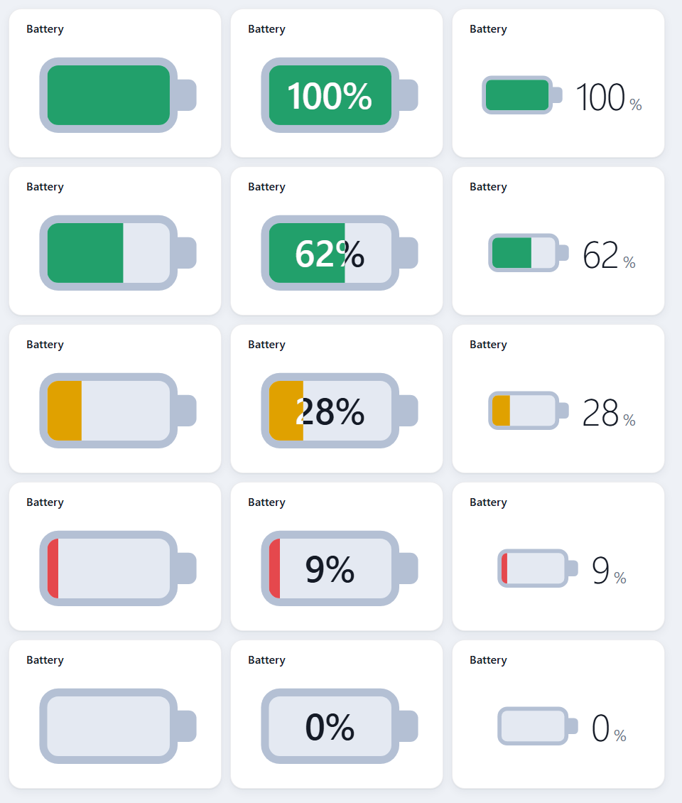 | 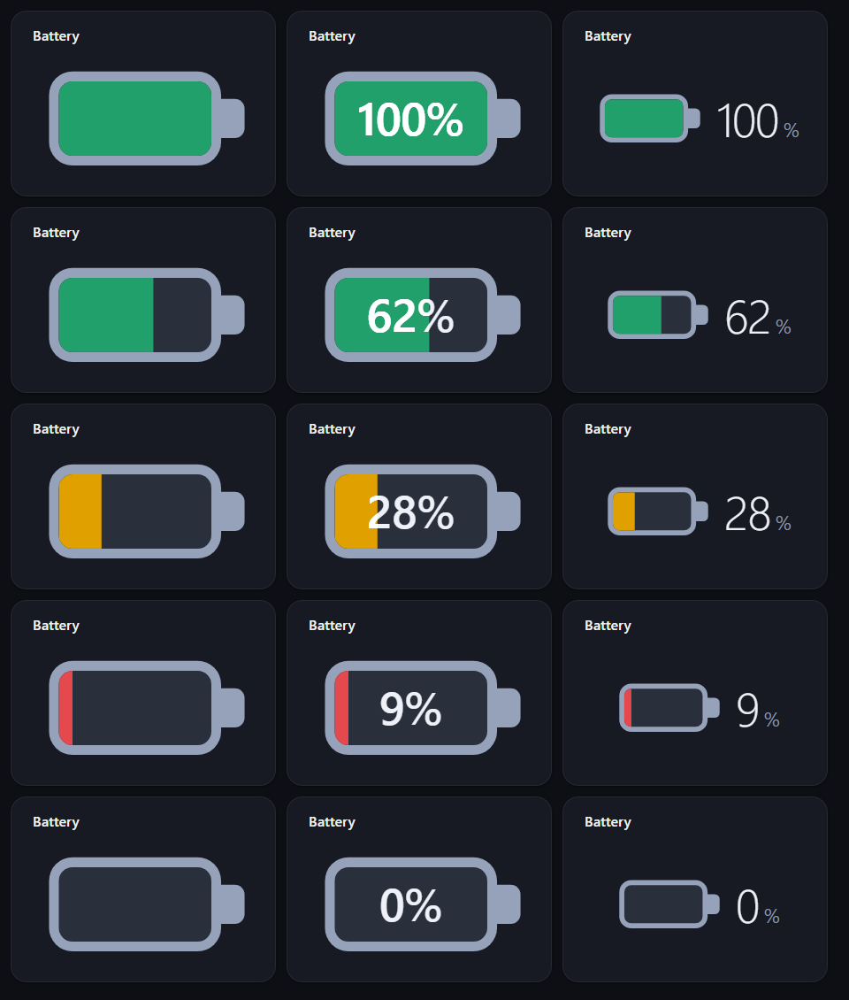 |

| Vertical, light | Vertical, dark |
|---|---|
| 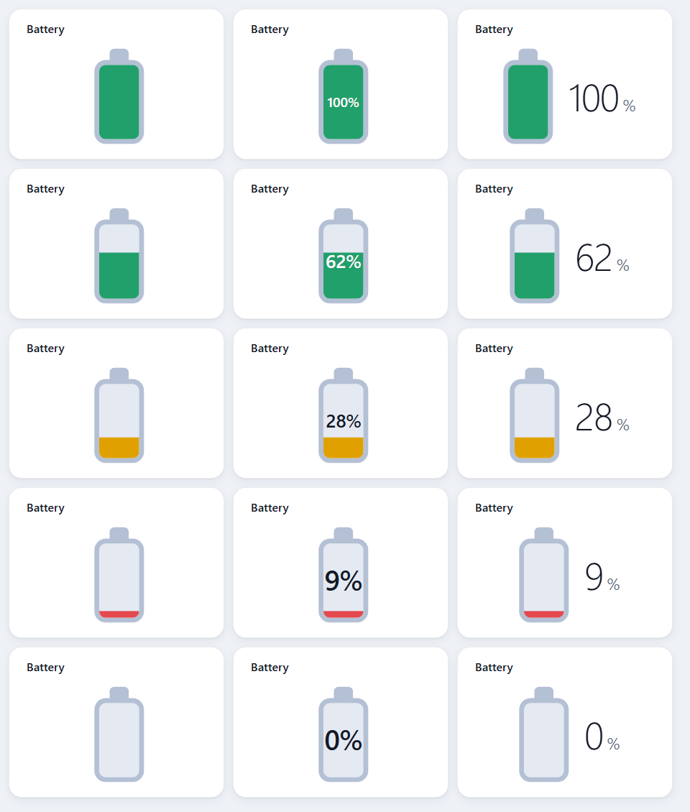 | 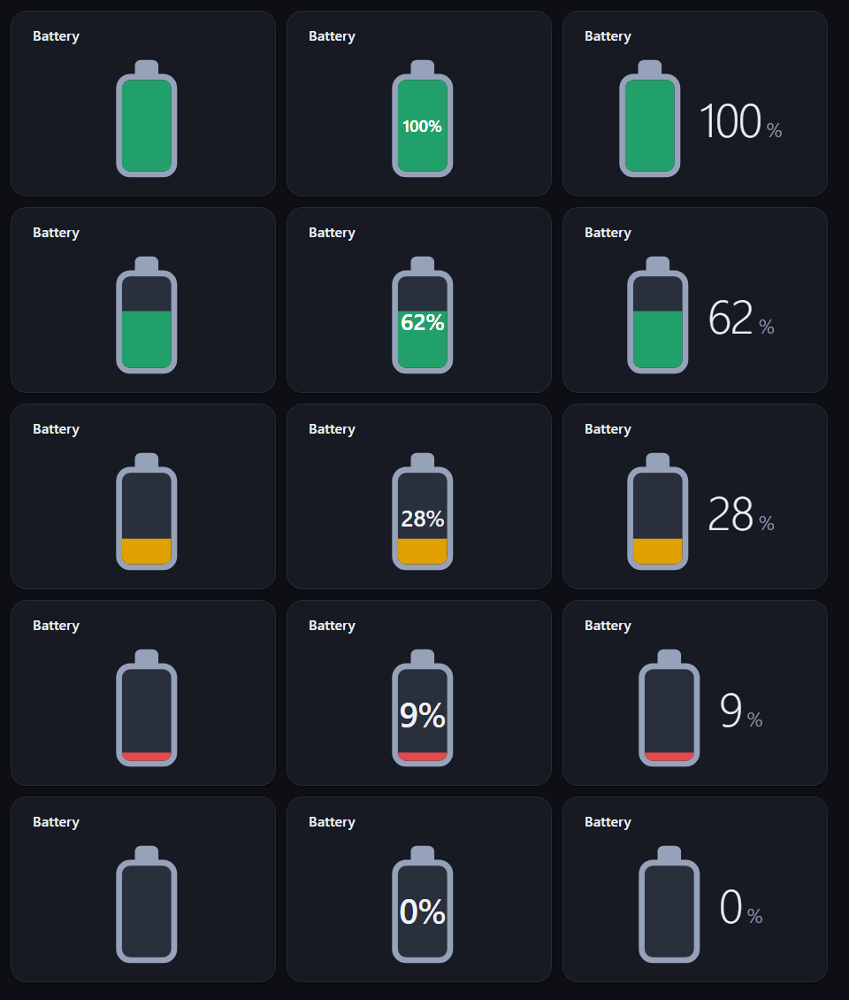 |

On small cards the icon shrinks to fit (dark theme):

| Horizontal | Vertical |
|---|---|
| 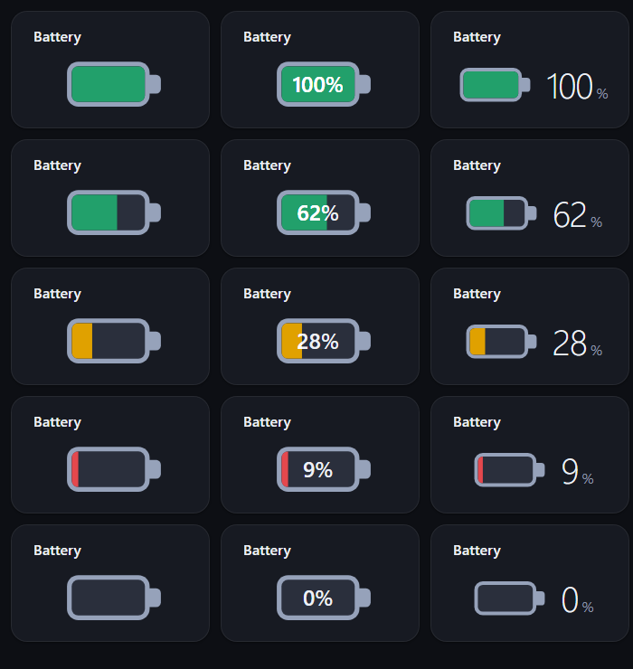 | 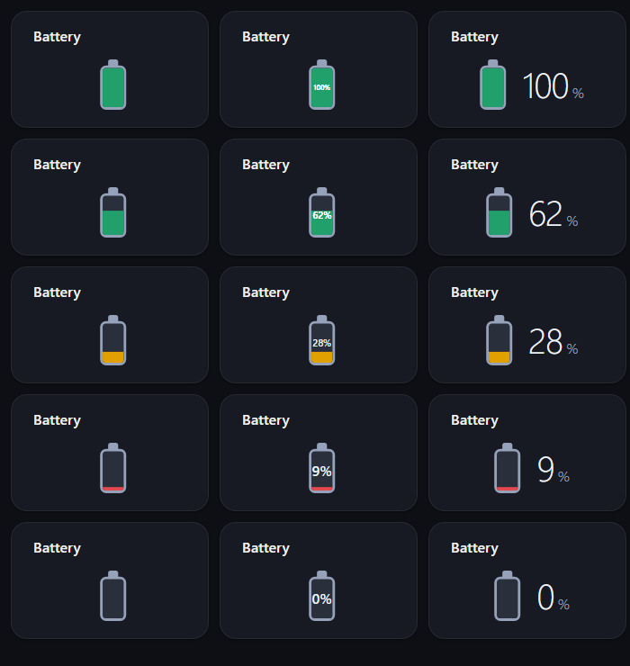 |

#### `batteryStyle: minimal`

A thin outline with a translucent fill in the accent color and light text, matching the stat and gauge displays. The color does not change with the charge and thresholds are not used.

| Horizontal, light | Horizontal, dark |
|---|---|
| 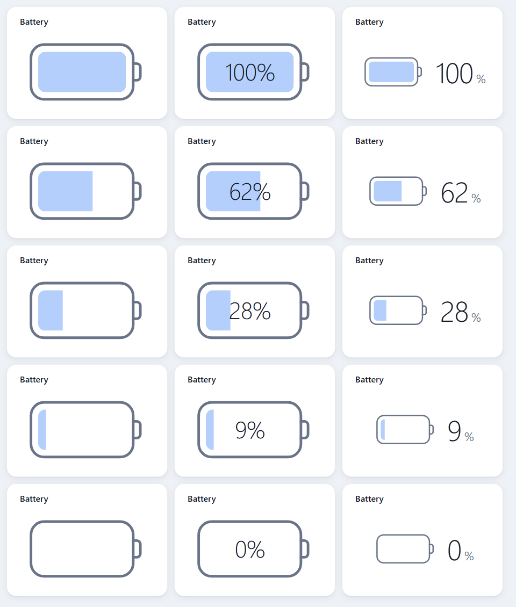 | 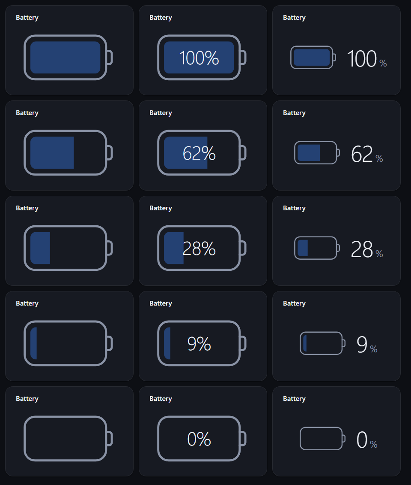 |

| Vertical, light | Vertical, dark |
|---|---|
| 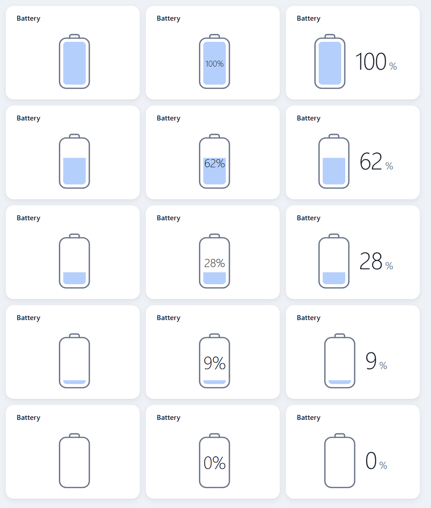 | 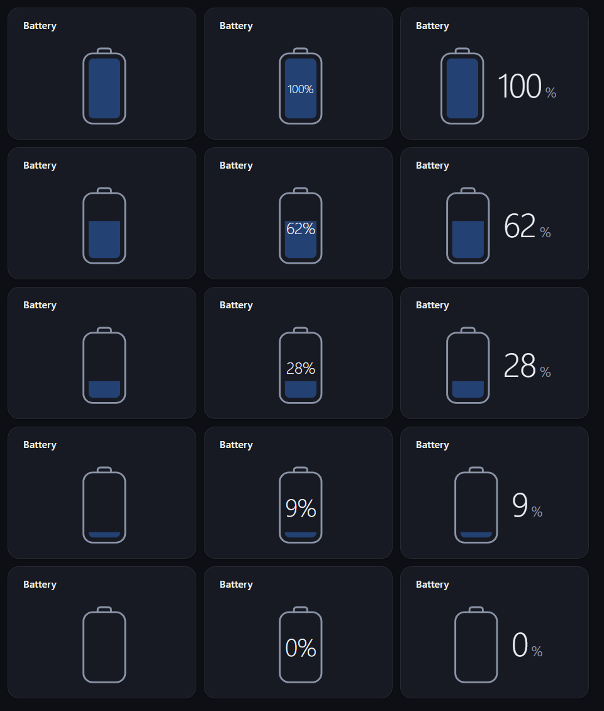 |

On small cards the icon shrinks to fit (dark theme):

| Horizontal | Vertical |
|---|---|
| 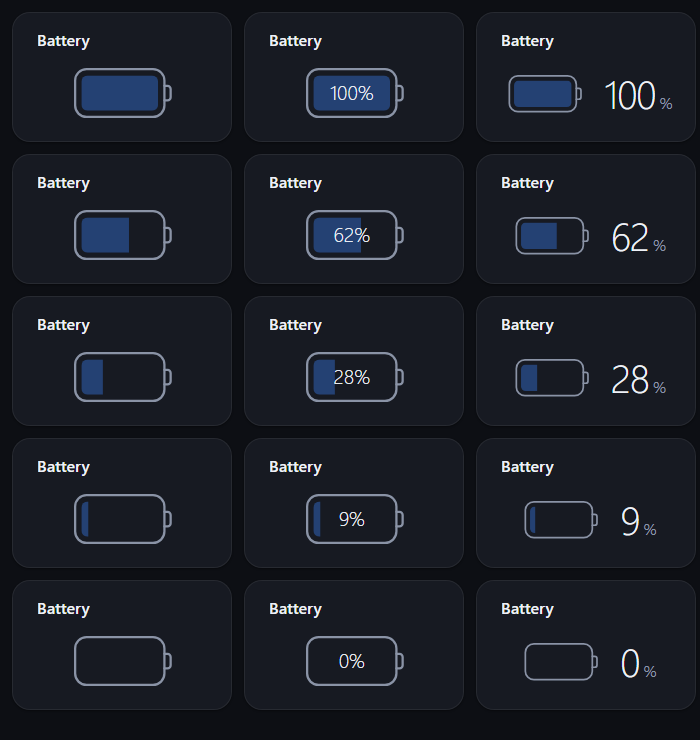 | 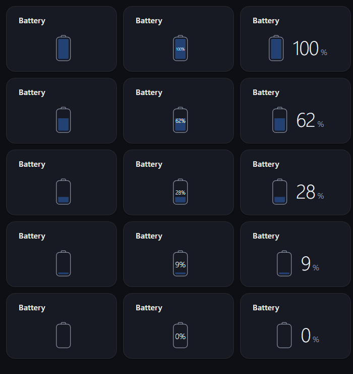 |

```yaml
connections:
  grafana:
    url: https://grafana.example.lan
    token: ${GRAFANA_TOKEN}

pages:
  - id: energy
    title: Energy
    widgets:
      # panel mode
      - id: power
        type: grafana.panel
        connection: grafana
        pos: { x: 0, y: 0, w: 4, h: 2 }
        settings:
          dashboard: PV Uebersicht
          panel: Verbrauchswerte
          range: 24h
      # query mode
      - id: up
        type: grafana.panel
        connection: grafana
        pos: { x: 4, y: 0, w: 2, h: 2 }
        settings:
          datasource: InfluxDB
          queries:
            - { refId: A, query: "from(bucket: \"home\") |> range(start: -6h)" }
          display: stat
          unit: watt
      # battery: the latest value as a battery icon (0-100, min/max are ignored)
      - id: soc
        type: grafana.panel
        connection: grafana
        pos: { x: 6, y: 0, w: 2, h: 2 }
        settings:
          dashboard: PV Uebersicht
          panel: Batterie
          display: battery
          batteryStyle: minimal
          batteryValue: inline
          batteryOrientation: vertical
```

---

## mqtt.value

Shows one numeric value of an MQTT topic as stat (big value with sparkline), gauge, chart or battery icon. The widget subscribes to the topic and updates live. The chart and sparkline cover what was received since Lumina started (nothing is persisted). Broker, login and TLS are set in the connection.

Connection options:

| Option | Type | Required | Default | Description |
|---|---|---|---|---|
| `url` | string | yes | | `host[:port]`; plain TCP by default (port 1883). Schemes `tcp`, `mqtt`, `ssl`, `mqtts` are accepted; no path. |
| `username` | string | no | | Login. |
| `password` | string | no | | Password; pass it as `${ENV}`. |
| `clientId` | string | no | `lumina-<random>` | Client name; the widget id is appended so several widgets can share a connection. |
| `tls` | bool | no | `false` | Encrypted connection (default port 8883); also implied by `ssl://` or `mqtts://`. |
| `caFile` | string | no | system roots | Trust this CA file instead of the system roots. |
| `insecureSkipVerify` | bool | no | `false` | Accept any server certificate (self-signed brokers). |

Widget settings:

| Setting | Type | Required | Default | Description |
|---|---|---|---|---|
| `topic` | string | yes | | Topic of one value. Wildcards (`+`, `#`) are not supported. |
| `valuePath` | string | no | the payload itself, or `value` if it is a JSON object | Path into a JSON payload, e.g. `value` or `data.soc`. |
| `title` | string | no | the topic | Heading. |
| `display` | string | no | `stat` | `stat`, `gauge`, `chart` or `battery`. |
| `batteryStyle` | string | no | `classic` | Only for `display: battery`. Look of the icon: `classic` (solid, colored by charge) or `minimal` (thin outline, one accent color). See [Battery display](#battery-display). |
| `batteryValue` | string | no | `side` | Only for `display: battery`. Where the number is shown: `none` (icon only), `inline` (inside the icon) or `side` (next to it). |
| `batteryOrientation` | string | no | `horizontal` | Only for `display: battery`. `horizontal` or `vertical` icon. |
| `range` | string | no | `6h` | Time range of the chart or sparkline, e.g. `30m`, `6h`, `1d`. |
| `unit` | string | no | | Unit id, e.g. `watt`, `percent`, `celsius`. |
| `decimals` | int | no | automatic | Fixed number of decimals (0-10). |
| `min` | number | no | | Lower bound (gauge); must be smaller than `max`. |
| `max` | number | no | | Upper bound (gauge). |
| `thresholds` | list | no | | Color steps `{ value, color }`; the first step has no `value` (base color). The color of the highest step at or below the value is used. `color` is a CSS color. |

`display: battery` works as for [`grafana.panel`](#battery-display) (see the screenshots there). With `batteryStyle: classic` the thresholds above color the fill.

```yaml
connections:
  mqtt:
    url: mqtt.local:1883
    username: lumina
    password: ${MQTT_PASSWORD}

pages:
  - id: energy
    title: Energy
    widgets:
      - id: battery
        type: mqtt.value
        connection: mqtt
        pos: { x: 4, y: 0, w: 2, h: 2 }
        settings:
          topic: victron/dc/soc
          valuePath: value
          title: Batterie
          display: gauge
          unit: percent
          min: 0
          max: 100
          thresholds:
            - { color: red }
            - { value: 20, color: orange }
            - { value: 50, color: green }
      # the same value as a battery icon (0-100, min/max are ignored); with batteryStyle classic the
      # fill color follows the thresholds, without thresholds it is red up to 15 %, orange up to 30 %, else green
      - id: battery-icon
        type: mqtt.value
        connection: mqtt
        pos: { x: 6, y: 0, w: 2, h: 2 }
        settings:
          topic: victron/dc/soc
          title: Batterie
          display: battery
          batteryStyle: classic
          batteryValue: inline
          batteryOrientation: vertical
```
