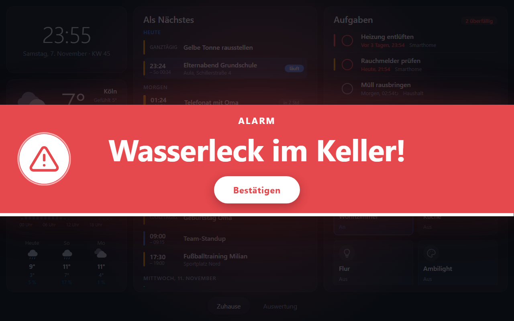
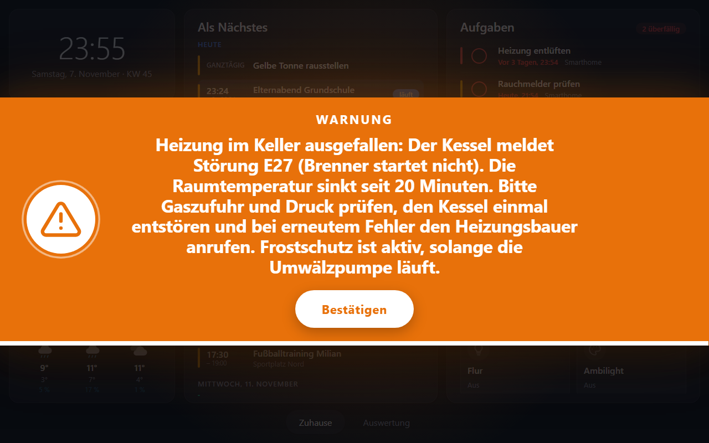
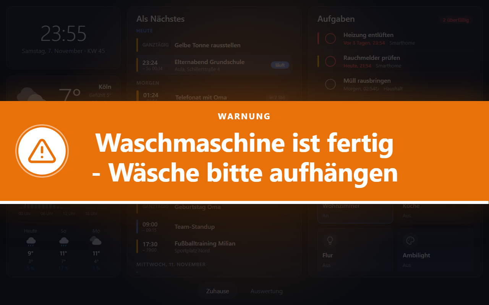
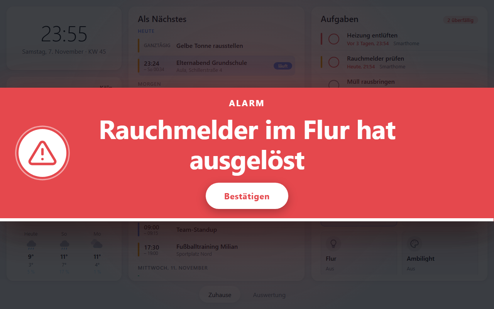

# Urgent alerts

Anything on your network (a script, openHAB, Grafana, a monitoring tool) can put an urgent message on every connected dashboard with one REST call. The message covers the whole screen, above the dashboard, night mode and toasts, until it times out or somebody confirms it.

| Red, with confirm button | Orange, long text (the type shrinks) |
| --- | --- |
|  |  |

| Orange, no button (disappears on its own) | Light theme |
| --- | --- |
|  |  |

The thin bar at the bottom of the card runs down to the time the alert disappears.

## Trigger an alert

`POST /api/alerts` with a JSON body:

| Field | Type | Required | Description |
| --- | --- | --- | --- |
| `text` | string | yes | The message, up to 600 characters. The longer the text, the smaller the type, so that it still fits. Line breaks (`\n`) are kept. |
| `color` | `red` \| `orange` | yes | `red` for an alarm, `orange` for a warning. Nothing else is accepted: the colors come from the theme. |
| `durationSeconds` | integer | yes | Seconds until the alert disappears on its own (1 to 86400). |
| `callbackUrl` | string | no | An absolute `http(s)` URL. If set, the overlay shows a **Confirm** button; without it there is no button. |

The answer is `201` with `{"id": "…", "expiresAt": "…"}`. An invalid request gets `400` and `{"error": "…"}`; unknown fields are rejected too, so a typo such as `colour` does not go unnoticed.

## Behaviour

- The alert is sent to all connected dashboards at once. A dashboard that connects (or reconnects) while the alert is active shows it with the remaining time.
- The overlay disappears when the time is over, when somebody confirms it (on any dashboard: it disappears everywhere), or when it is removed with `DELETE /api/alerts/{id}`.
- With several active alerts the newest is shown, with a "+ n more" hint; the older ones appear again when it is gone. At most 10 alerts are active at once, the oldest one makes room.
- An alert without a confirm button cannot be closed on the tablet. Use a short `durationSeconds`, or `DELETE` it.
- **Confirm:** the tablet only tells the backend which alert was confirmed. The backend then calls the `callbackUrl` it stored when the alert was triggered (the URL never reaches the browser) with `POST` and the JSON body `{"alertId": "…", "confirmed": true, "confirmedAt": "…"}`. Redirects are not followed. If the answer is `2xx`, the alert disappears everywhere. If the call fails, the alert stays visible and a hint asks to try again; the log shows the host and the reason, never the URL (it may contain a token).

## Try it with PowerShell

Start the demo (`.\scripts\demo.ps1`) and use the helper script in a second window:

```powershell
# red alarm with confirm button for 60 seconds
.\scripts\send-alert.ps1 -Text 'Water leak in the basement!' -Color red -Seconds 60 -Confirm

# orange warning without button, disappears after 20 seconds
.\scripts\send-alert.ps1 -Text 'Washing machine is done' -Color orange -Seconds 20

# after pressing the button: what did the callback receive?
.\scripts\send-alert.ps1 -ShowCallbacks

# remove an alert early (id from the answer of the trigger call)
.\scripts\send-alert.ps1 -Dismiss 9d14c563d67dfb92
```

`-Confirm` uses the callback recorder of the demo services (`http://localhost:18080/alert-callback`, change it with `-CallbackUrl`); `-Lumina` points the script at another Lumina (default `http://localhost:8080`).

The plain REST call, without the script:

```powershell
$body = @{
  text            = 'Water leak in the basement!'
  color           = 'red'
  durationSeconds = 60
  callbackUrl     = 'http://localhost:18080/alert-callback'   # optional: adds the confirm button
} | ConvertTo-Json

Invoke-RestMethod -Method Post -Uri http://localhost:8080/api/alerts `
  -ContentType 'application/json; charset=utf-8' `
  -Body ([Text.Encoding]::UTF8.GetBytes($body))
```

With curl:

```sh
curl -X POST http://localhost:8080/api/alerts -H 'Content-Type: application/json' \
  -d '{"text":"Water leak in the basement!","color":"red","durationSeconds":60}'
```

## Security

Like the rest of Lumina the endpoint has no login: it is meant for the LAN only. Everybody who can reach Lumina can show an alert, and can make Lumina send a `POST` to a URL of their choice (the callback), so do not expose Lumina to the internet. Put a reverse proxy with authentication in front of `/api/alerts` if you need to accept alerts from outside.

## Protocol

Three WebSocket messages carry it (see [ADR-003](adr/003-websocket-protocol.md)): `alert` (server to client, payload `Alert`: `id`, `text`, `color`, `remainingMs`, `confirmable`), `alert_clear` (server to client, `{id}`) and `alert_confirm` (client to server, `{id}`, answered with `action_result`). The types are generated from `core/protocol.go`; the logic is in `backend/internal/core/alerts.go`, the endpoint in `backend/internal/server/server.go`, the overlay in `frontend/src/components/AlertOverlay.svelte`.
